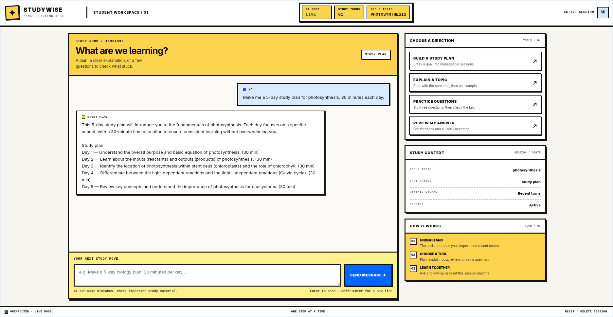
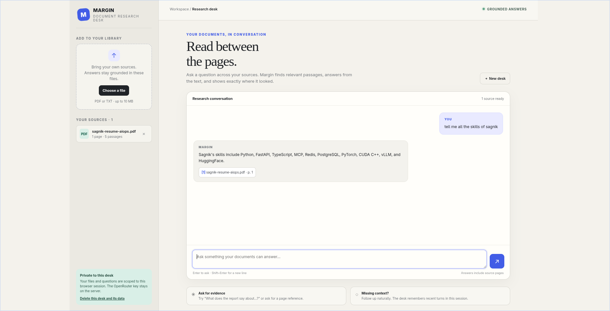

# Aspirant League assessment projects

Projects are kept in separate directories so each can be built and reviewed independently.

## Live demos

### Studywise — AI Study Assistant

[Open Studywise](https://studywise-l3zo.onrender.com/)

### Margin — Document Research Desk

[Open Margin](https://margin-document-qa.onrender.com/)

## Project folders

- **Studywise — AI Study Assistant:** [`studywise/`](studywise/). See its [README](studywise/README.md) for setup, architecture, tests, deployment, and evaluation.

- **Margin — Document Research Desk:** [`document-qa/`](document-qa/), the document retrieval and Q&A assessment project. See its [README](document-qa/README.md) for setup, sample documents, evaluation, and its Render Blueprint at [`document-qa/render.yaml`](document-qa/render.yaml).
