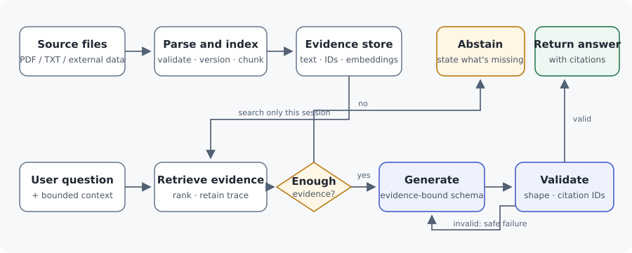

# Making a GenAI application more reliable

**Mandatory reasoning challenge**  
Sagnik Das · 20 November 2026

## The problem

An LLM application can fail in several different places while showing the same symptom: a bad answer. The model may be working from weak evidence, retrieval may have selected the wrong passages, a response may not match the expected structure, or a provider may be slow or unavailable. Answers can also vary because generation and hosted models are not perfectly repeatable.

I would treat reliability as a property of the whole request path. The application should be able to show what evidence it used, check that the response is usable, and say when the evidence is not good enough.

## How I would investigate a bad answer

I would first save a reproducible case: the question, session context, document or external-data version, retrieved passage IDs and scores, prompt version, model identifier, generation settings, response status, latency, and validation outcome. A request ID should connect these events. Logs should avoid retaining document text or secrets unless there is a clear, access-controlled reason to do so.

Then I would replay the case and check each stage in order:

1. **Input and extraction:** Was the source readable and complete? Did PDF parsing lose a table, page, or important line?
2. **Retrieval:** Did the expected passage make the top results? Were chunks too broad, too small, duplicated, or mismatched to the query?
3. **Generation:** Was the answer supported by the passages actually supplied? Did instructions conflict, or did the model add facts from its own knowledge?
4. **Validation and delivery:** Did the result pass the response schema and citation checks? Did a timeout, retry, or frontend error change what the user saw?

This order helps distinguish a retrieval miss from a generation error. Changing the prompt before checking the source and retrieved passages can hide the real problem.

## Proposed request flow

The diagram shows a document-grounded question answering flow. The same controls apply when the external information comes from another service: identify and version the evidence source, set a time budget for it, validate its response, and keep the evidence trace with the answer.

Each stage has a narrow responsibility. Parsing and retrieval decide what evidence is available; a relevance gate decides whether there is enough to answer; the model drafts a response from the selected evidence; application checks decide whether that response can safely be returned. If a check fails, the system returns a clear no-answer or retry message rather than displaying a plausible but unverified answer.

## Which layer should address each issue?

| Symptom | Best place to address it |
|---|---|
| Confident answer unsupported by sources | Retrieval threshold and evidence-only instructions reduce the risk. The application checks citation IDs and abstains when evidence is weak. Human review is still needed to judge whether each cited passage supports each claim. |
| Irrelevant passages | Check extraction first, then chunking, embeddings, query formulation, and ranking. Compare dense retrieval with a lexical or hybrid baseline on labeled queries before adding a reranker. |
| Invalid or unexpected format | Request schema-constrained output where supported, then parse and validate it in application code. Never rely on prompt wording alone for a machine-readable contract. |
| API timeout or failure | Use explicit connect/read timeouts and bounded retries for transient failures. Do not retry permanent input or authentication errors. Return a useful status, avoid saving partial work, and add a circuit breaker or queue only when traffic warrants it. |
| Different answers to the same query | Fix and log the model, prompt, settings, corpus, and retrieval result for comparisons. A low temperature can reduce variation, but cannot make a changing hosted model perfectly deterministic. Measure variation across repeated runs. |

Prompts can explain how to use evidence and handle conflicts; they cannot guarantee factuality. Model choice affects cost, latency, structured-output support, and answer quality. Application logic should enforce limits and invariants, while evaluation and monitoring reveal regressions that none of those controls can prevent alone.

## How I would measure it

I would keep a small, labeled set of representative questions and expected source passages, including answerable questions, ambiguous questions, conflicting documents, and questions whose answers are absent. For retrieval, I would report Recall@1 and Recall@5 and mean reciprocal rank. For answers, I would review whether claims are supported by cited passages, whether citations point to valid sources, and whether unsupported questions correctly lead to abstention. I would also track extraction and schema failures, provider errors, latency by stage, and token or embedding cost.

The existing Margin evaluation set has 15 questions across three sample documents, including an intentionally unanswerable question. Its live run has not been completed in this environment because the OpenRouter key is not available locally. I therefore do not claim measured live retrieval or answer-quality scores here. The offline tests use controlled responses; they check application behavior, not real-world semantic accuracy. Generated answers still need human support review.

For Studywise, I would add a fixed set of multi-turn requests with expected actions, including an ambiguous request and provider or malformed-output failures. I would measure routing accuracy, correct clarification, schema validity, recovery behavior, latency, and cost. The router is constrained to a small set of structured actions, and the application invokes one capability per turn with bounded history and execution. This makes behavior easier to inspect than an open-ended tool loop, though it does not prove every generated explanation is correct.

When a case fails, I would change one factor at a time and rerun the same set. This makes it possible to tell whether a gain came from extraction, retrieval, prompt, model, or threshold changes, and to notice regressions on previously working cases.

## Decisions and trade-offs

For Margin, I chose page-aware overlapping chunks and cosine ranking because they are straightforward to inspect for a small assessment corpus. A score threshold allows the app to abstain before paying for answer generation. PostgreSQL keeps session data, passages, and embeddings together without another service, but scanning vectors in application code will not scale to a large library; measured growth would justify pgvector or a dedicated vector store. The initial version does not include OCR, so scanned PDFs are rejected rather than silently treated as empty evidence.

For Studywise, I used a structured router and explicit application dispatch. Plans, quizzes, and response checks are distinct capabilities, while the backend owns validation, persistence, and limits. This is less flexible than a general agent that can call tools repeatedly, but it is easier to bound, debug, and evaluate. For both apps, a smaller model and a simple pipeline keep cost and operational burden low; if evaluation shows poor quality, I would compare a stronger model or reranker against the same cases before accepting the added cost and latency.

The practical rule is to answer only when the evidence and output pass checks. Otherwise, explain what is missing, ask a clarifying question, or invite the user to try again after a temporary service failure.
