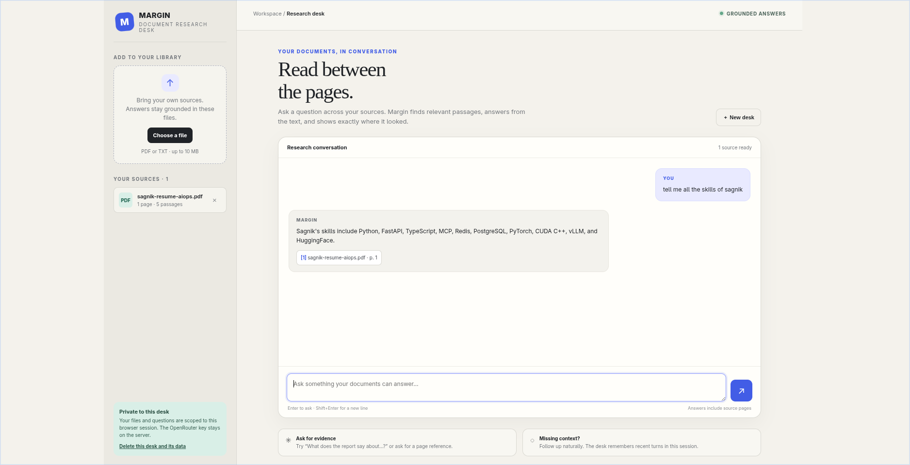

# Margin — Document Research Desk

Margin is the second technical-assessment project: a document-grounded question-answering workspace (Problem Statement 1). Upload PDF or UTF-8 text, ask questions across the documents in a browser session, and inspect the passages cited by each answer. If retrieval is weak, the app abstains.

The visual direction is intentionally distinct from Studywise: a cool editorial research desk with a source library, open paper workspace, indigo accents, and compact citation cards.



## Run locally

Requires Python 3.12+ and an OpenRouter API key for document indexing and generated answers.

```bash
cd document-qa
python -m venv .venv
source .venv/bin/activate
pip install -r requirements-dev.txt
cp .env.example .env
# Add OPENROUTER_API_KEY to .env
alembic upgrade head
uvicorn app.main:app --reload
```

Open <http://127.0.0.1:8000>. Swagger UI is at `/api/docs`. The default database is local SQLite for development. The app uses `google/gemini-2.5-flash-lite` for generation and `openai/text-embedding-3-small` with 512 dimensions for retrieval; both models can be changed with environment settings. The OpenRouter key is used only on the server. Do not commit `.env`.

## What it does

- Accepts selectable-text PDF and UTF-8 TXT files (10 MB per file, at most 150 PDF pages and 800 chunks per document).
- Extracts text by page, normalizes whitespace, and creates 180-word passages with 30-word overlap.
- Calls OpenRouter's embeddings endpoint in batches, stores extracted passages and vectors in PostgreSQL, and ranks session-scoped passages with cosine similarity.
- Uses recent conversation turns to resolve short follow-up questions; the generation prompt receives only the current session's recent turns and selected passages.
- Requires structured JSON answers with citations to retrieved passage IDs. Unknown citation IDs are discarded; if no valid citation remains, the API abstains.
- Abstains before generation when the best cosine score is below the configurable `MIN_RELEVANCE_SCORE` (initial default 0.28).
- Stores chat history and citations, supports document/session deletion, limits request sizes, and applies a per-process request rate limit.

Scanned/image-only PDFs, OCR, password-protected PDFs, and handwriting are rejected with a clear message. The app stores extracted text and vectors, not original uploaded bytes.

## Deploy on Render

This project has its own Blueprint at [`render.yaml`](render.yaml), separate from the Studywise Blueprint. It creates a separate web service but reuses the existing `studywise-db` PostgreSQL instance and `studywise` service's OpenRouter key. Document Q&A uses the dedicated `document_qa` PostgreSQL schema (and its own Alembic version table), so its tables do not collide with Studywise's tables. The container runs `alembic upgrade head` before starting FastAPI.

The Blueprint provisions only a free web service; it does not create another database. Free web services sleep when idle and have ephemeral local storage, so all user data is kept in PostgreSQL. The database is shared at the infrastructure level, but the app's schema keeps tables and migrations separate. This is logical namespace isolation, not a separate database-user security boundary. Render's free PostgreSQL expires after 30 days and is not suitable for production retention. Set a deletion/retention policy before storing real or sensitive documents. See [Render's Free instance limitations](https://render.com/docs/free) and [Blueprint setup](https://render.com/docs/infrastructure-as-code).

## Verification

Run the offline suite (fake provider; no API credits used):

```bash
PYTEST_DISABLE_PLUGIN_AUTOLOAD=1 python -m pytest -q
ruff check app tests evals
```

Run the labeled live embedding retrieval evaluation after setting the key:

```bash
python -m evals.run_eval
```

This evaluates 15 fixed questions over the three checked-in sample sources and reports Recall@1, Recall@5, MRR, nearest-score abstention for one unsupported query, and source rankings. The 15-case report is written to `evals/latest-report.json`. To also generate answers for human support review (additional paid model calls), run `python -m evals.run_eval --answers`. Review each generated answer against the matching passages; valid citation IDs alone do not prove factual support. The evaluation protocol and current status are in [the evaluation report](docs/evaluation.md).

## Assessment deliverables

- [Architecture and data flow](docs/architecture.md)
- [Technical decisions](docs/decisions.md)
- [Retrieval evaluation protocol and results status](docs/evaluation.md)
- [GenAI Engineer reasoning challenge](docs/genai-reliability-challenge.md)
- [Demo walkthrough](docs/demo-script.md)
- [AI tool disclosure](docs/ai-tool-disclosure.md)
- [Known limitations](docs/limitations.md)
- Sample documents: `sample-documents/`
- Labeled evaluation queries: `evals/queries.json`

## API

| Method | Path | Purpose |
|---|---|---|
| `GET` | `/health/live` | Process liveness |
| `GET` | `/health/ready` | Database and provider configuration status |
| `POST` | `/api/sessions` | Create an isolated document desk |
| `GET` | `/api/sessions/{id}` | Read recent chat history |
| `DELETE` | `/api/sessions/{id}` | Delete desk, documents, chunks, and history |
| `GET` | `/api/documents?session_id={id}` | List sources in a desk |
| `POST` | `/api/documents` | Multipart upload (`session_id`, `file`) |
| `DELETE` | `/api/documents/{id}?session_id={id}` | Delete one source and its chunks |
| `POST` | `/api/chat` | Ask a question (`session_id`, `question`) |

OpenAPI docs are at `/api/docs`. Error responses use standard HTTP status codes and do not return provider credentials or raw provider payloads.
