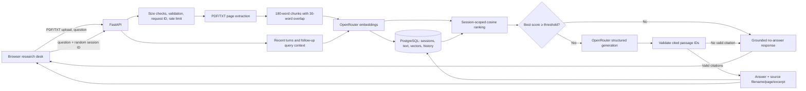

# Architecture

## Request flow

1. The browser creates a random UUID session. API operations scope all documents, chunks, and conversation history to that ID.
2. An upload is size-checked, deduplicated per session by SHA-256, and validated by extension and content. PDFs are parsed per page; text files use strict UTF-8 decoding. Empty/scanned PDFs are rejected because OCR is outside this release.
3. Page text is whitespace-normalized and split at word boundaries into overlapping chunks. Each chunk keeps its page number. Embeddings are generated in batches of at most 64.
4. Extracted text and embeddings are committed to PostgreSQL only after every batch succeeds. The raw upload bytes are not persisted. Duplicate uploads return 409; failures do not create a partially indexed document.
5. For a question, a short pronoun-led follow-up is expanded with the previous user question. The query is embedded, then cosine scores are calculated only over chunks belonging to the active session.
6. If no chunk meets the relevance threshold, the app returns an abstention without a generation call. Otherwise, the selected passages and at most six recent turns are sent to the chat model with a strict JSON Schema and instructions to treat document content as untrusted evidence.
7. The API accepts citations only when their IDs match passages sent to the model. It returns source filename, page, a text excerpt, and similarity score; unknown IDs cause abstention. Valid IDs do not guarantee every generated claim is supported, so the evaluation includes manual answer review.

## Boundaries

- The OpenRouter key exists only in the server environment. Browser requests never contain it.
- PostgreSQL persists sessions, extracted text, embeddings, messages, and citations. The browser stores only its session UUID in tab-scoped session storage.
- Rate limiting is per process and source IP. The free blueprint runs one web instance; multiple replicas need a shared rate limiter.
- The initial vector store is JSON embeddings in PostgreSQL with an application-side scan, capped at 2,000 chunks per desk. It avoids a vector-extension dependency for a small assessment corpus. Use pgvector or a dedicated vector store after measured corpus growth.
- The Render Blueprint is separate at `document-qa/render.yaml`; it provisions a separate web service and database.
