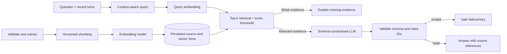

# Think Like a GenAI Engineer

## Failure causes and investigation

**Confident incorrect answers** can come from weak or conflicting evidence, a query that does not match the corpus, truncated context, an instruction hidden in the document, or model knowledge leaking beyond sources. Log a request ID, session-scoped retrieval scores, selected chunk IDs, model/config version, latency, provider status, schema validity, and citations. Avoid logging raw documents or API keys by default. Reproduce failures with the same query, corpus, prompt, and model configuration.

**Irrelevant retrieval** can come from poor PDF extraction, chunk boundaries, query wording, a mismatched embedding model, or near-duplicate/conflicting passages. Inspect extracted text first, then compare the expected source rank and score on a fixed query set. Separate extraction failures from ranking failures.

**Unexpected output format** can result from provider/model support differences or malformed/truncated responses. Request strict JSON Schema output, parse it at the boundary, validate required fields and citation IDs, and fail safely instead of rendering raw output.

**Slow or failed APIs** can come from cold starts, rate limits, provider outages, large embedding batches, or timeouts. Measure embedding and generation latency separately. Bound request time, return sanitized retry guidance, and avoid storing an incomplete index.

**Nondeterministic answers** can come from sampling, model/provider changes, evolving prompts, or ties among similar chunks. Use temperature zero, log model identifiers and configuration, preserve the retrieval trace, and test behavior over repeat runs rather than treating one answer as conclusive.

## Proposed pipeline

## Which layer should solve which issue?

- **Prompt/model:** clear evidence-only instructions, conflict handling, JSON Schema output, low temperature, and concise answers.
- **Retrieval:** inspect parser output, tune chunking/overlap and embedding model, calibrate relevance threshold, compare hybrid lexical+dense retrieval or reranking using labeled cases.
- **Application logic:** file limits, session isolation, deterministic abstention, citation allow-list, schema validation, bounded timeouts, sanitized errors, rate limit, and no partial index commit.
- **Operations/evaluation:** request IDs, latency/provider metrics, fixed query set, human review for source support, and monitoring for model/config drift.

Prompt engineering cannot guarantee truth. When evidence is absent or conflicting, the product should say so and cite the available passages, not fill gaps with outside knowledge.

## Quality checks and trade-offs

Track retrieval Recall@1/5 and MRR, unsupported-query abstention, citation-ID validity, human-rated claim support, extraction failures, schema failure rate, provider latency, and token/embedding use. The checked-in evaluator provides the retrieval and threshold measures; `--answers` records candidate answers for human review.

The current approach favors low operational complexity and low-cost models. Smaller embedding vectors reduce database and transfer cost but may lower recall. Raising the relevance threshold lowers unsupported responses but can increase false abstention. Adding a reranker or local model may improve quality or privacy, with more latency and operational complexity. A single synchronous service suits the assessment corpus; a larger concurrent workload needs a queue, shared rate limiting, and indexed vector search.
