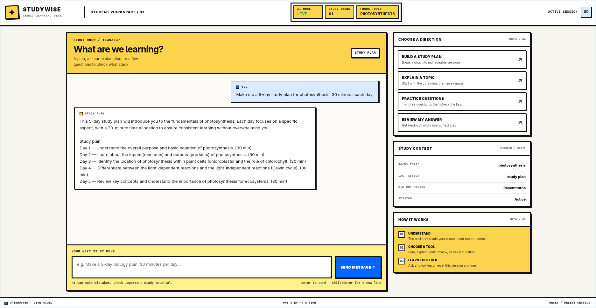

# Studywise — AI Study Assistant

An AI study assistant built for Aspirant League Assessment Problem 3. It routes student requests to a study-plan, explanation, quiz, or answer-feedback capability; asks for clarification when needed; preserves conversation history; and validates model output before returning it.



## Run locally

Requires Python 3.12+.

```bash
python -m venv .venv
source .venv/bin/activate
pip install -r requirements-dev.txt
cp .env.example .env
uvicorn app.main:app --reload
```

Open <http://127.0.0.1:8000>. With no OpenRouter key the app runs in **demo mode** so the UI and session flow work offline; responses are fixed examples, not generated teaching. The default is the lower-cost `google/gemini-2.5-flash-lite`; change `OPENROUTER_MODEL` to another model that supports JSON Schema structured outputs if needed. OpenRouter's chat completions API is called at `/api/v1/chat/completions`. Keep the key only in `.env` or the hosting platform's secret store. Do not commit `.env`.

The dashboard styling takes inspiration from [Zerch](https://github.com/sagnik3788/Zerch): warm paper colors, bold yellow panels, black borders, and compact dashboard cards. Studywise's interface and implementation are original.

## Deploy with Docker Compose

Set these values in `.env` first: `DB_PASSWORD` and `OPENROUTER_API_KEY`. Use a long random hexadecimal database password (for example, `openssl rand -hex 32`) so it is safe in the database URL, then run:

```bash
docker compose up --build -d
```

Compose runs PostgreSQL 16 with a persistent volume. The app container runs Alembic migrations before starting Uvicorn as an unprivileged user. The app has a liveness health check and restarts on failure. Set `OPENROUTER_MODEL` to a model available to your OpenRouter account. Visit <http://localhost:8000>. For a public internet deployment, put the service behind HTTPS and a reverse proxy, rotate secrets, and use a managed PostgreSQL service with backups.

## Deploy on Render

The repository-root `render.yaml` defines a free Docker web service and PostgreSQL database for the `studywise/` directory. Create a new Blueprint in Render and connect this GitHub repository. Render prompts for `OPENROUTER_API_KEY` and wires the database URL. The provider key stays server-side. The app accepts Render's standard PostgreSQL URL format and applies Alembic migrations on startup. Free web services sleep after inactivity and free Render Postgres expires after 30 days, so this setup is for a short assessment demo. See [Render deployment steps](docs/deploy-render.md).

## Product behavior

- **Study plan:** create a time-bounded plan for a stated subject or topic.
- **Explain:** give a level-aware explanation, example, key points, and check question.
- **Quiz:** generate three practice questions and an answer key.
- **Evaluate:** give constructive feedback on a student's response without inventing a score.
- **Clarify:** ask for missing topic or intent instead of guessing.
- **Context:** keep full history in the database, but send only the latest `MAX_HISTORY_MESSAGES` messages plus compact session state to the router and tool.
- **Failure handling:** bound each OpenRouter call with a timeout, retry transient failures or malformed JSON once, enforce JSON Schema and local validation, and return a safe recoverable message if the workflow fails.

The route is a small explicit state machine in `app/agent.py`, not a free-running autonomous loop: each turn chooses one action, then makes at most one corresponding tool-generation call. This is equivalent to a conditional agent workflow and keeps execution bounded.

## API

OpenAPI docs: `/api/docs`. The API uses no app access key; `OPENROUTER_API_KEY` is used only by the server for model calls.

| Method | Path | Purpose |
|---|---|---|
| `GET` | `/health/live` | Liveness check |
| `GET` | `/health/ready` | Database readiness and model configuration status |
| `POST` | `/api/sessions` | Create a conversation |
| `GET` | `/api/sessions/{session_id}` | Read conversation history |
| `DELETE` | `/api/sessions/{session_id}` | Delete a conversation and its messages |
| `POST` | `/api/sessions/{session_id}/messages` | Route and answer a student turn |

Example turn: `POST /api/sessions/{id}/messages` with `{"content":"Quiz me on photosynthesis"}`. Responses contain an action, user-facing answer, structured supporting fields, routing rationale, and `mode` (`demo` or `openrouter`).

## Verification

Install dev dependencies and run:

```bash
PYTEST_DISABLE_PLUGIN_AUTOLOAD=1 python -m pytest -q
ruff check app tests evals
```

Tests use fake model responses and an isolated SQLite database; they do not spend API credits. The live evaluation has 15 fixed requests (three per action) and records exact routing accuracy, non-empty responses, latency, and token counts:

```bash
python -m evals.run_live
```

It writes `eval-results/live-report.json`. The completed 15-case run and the later incomplete retry are documented in the [live evaluation summary](docs/live-evaluation-summary.md); the checked-in [incomplete report](evals/incomplete-live-report.json) records the OpenRouter HTTP 402 response. Review generated teaching quality manually using [the evaluation guide](docs/evaluation.md). Live model quality still requires human review.

## Project documents

- [Architecture and data flow](docs/architecture.md)
- [Technical decision log](docs/decisions.md)
- [Evaluation plan and scorecard](docs/evaluation.md)
- [Live evaluation summary](docs/live-evaluation-summary.md)
- [Demo script](docs/demo-script.md)
- [AI tool disclosure](docs/ai-tool-disclosure.md)
- [Known limitations](docs/limitations.md)
