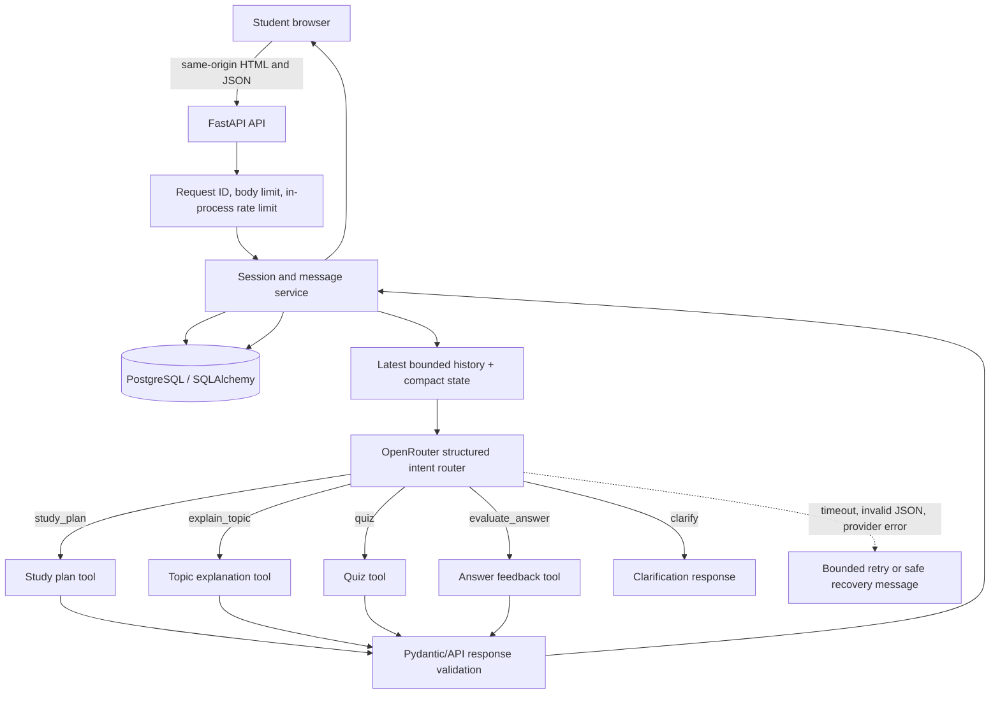

# Architecture

## A turn, end to end

1. The browser sends a message and session ID. The API validates length, applies the process-local rate limit, and assigns a request ID.
2. The API loads the session state and the most recent `MAX_HISTORY_MESSAGES` rows. It releases the read transaction before making network calls.
3. The router receives the current request, recent conversation, and compact state. It must return a strict JSON Schema object with one of five actions, typed parameters, and a short rationale tied to the wording or context.
4. `clarify` ends the turn. Otherwise a conditional dispatch invokes exactly one named study capability. The capability receives the user request, selected action, and bounded context and returns a structured answer.
5. OpenRouter's JSON Schema response mode is followed by local shape checks. Invalid or failed workflows return a safe retry message; no arbitrary Python execution or unbounded tool loop exists.
6. The user and assistant messages are persisted together with updated topic state. The response includes the chosen action and a plain-language rationale for demos and evaluation.

## State and storage

PostgreSQL stores conversation sessions, messages, timestamps, and one small JSON session-state object. Session IDs are random UUIDs and also serve as unguessable resource identifiers. The UI stores its active session ID in tab-scoped session storage. A user can reset/delete the conversation. OpenRouter receives only recent context, not unrelated sessions. The OpenRouter key stays in the server environment and is never sent to the browser.

## Deployment boundary

Compose runs one API process and one PostgreSQL service. A managed database, TLS reverse proxy, and external rate limiting are appropriate for a public deployment. The bundled rate limiter is per process and per source IP; it is a small deployment guard, not a distributed abuse-control system.
